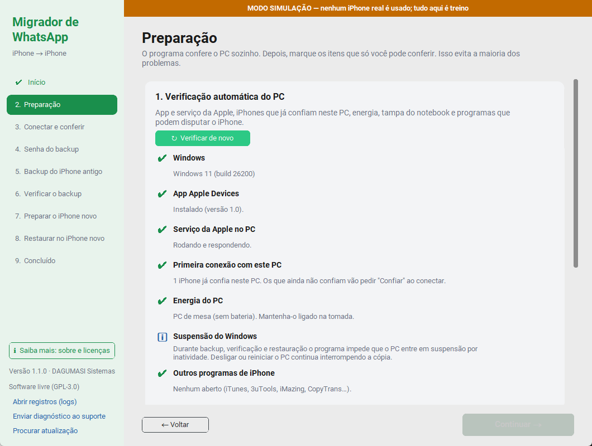
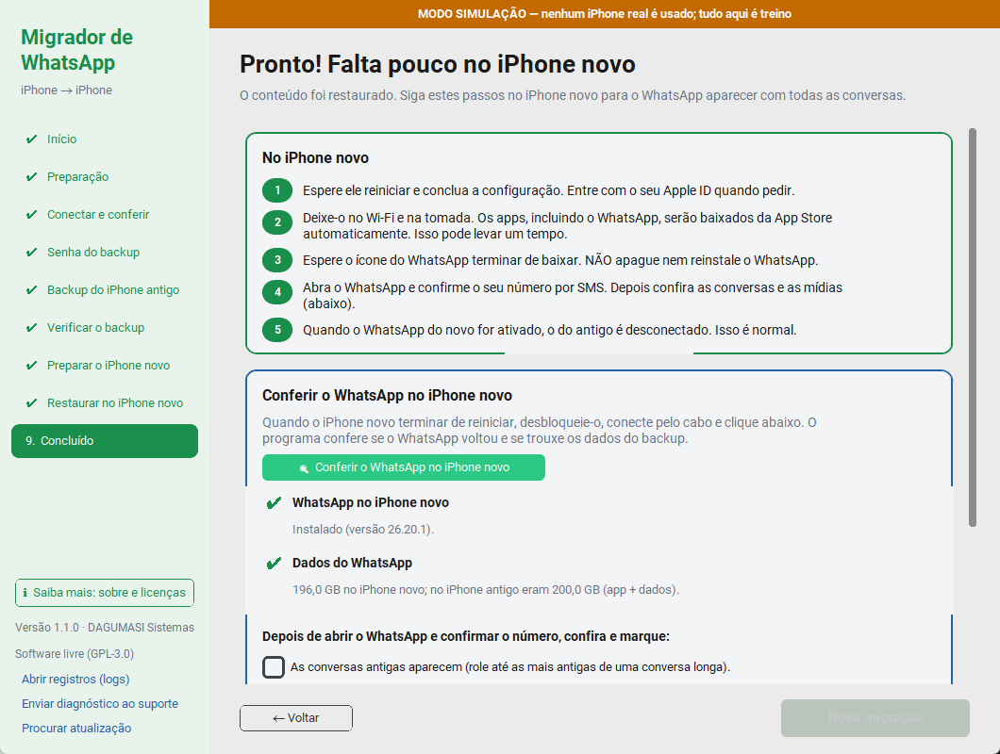
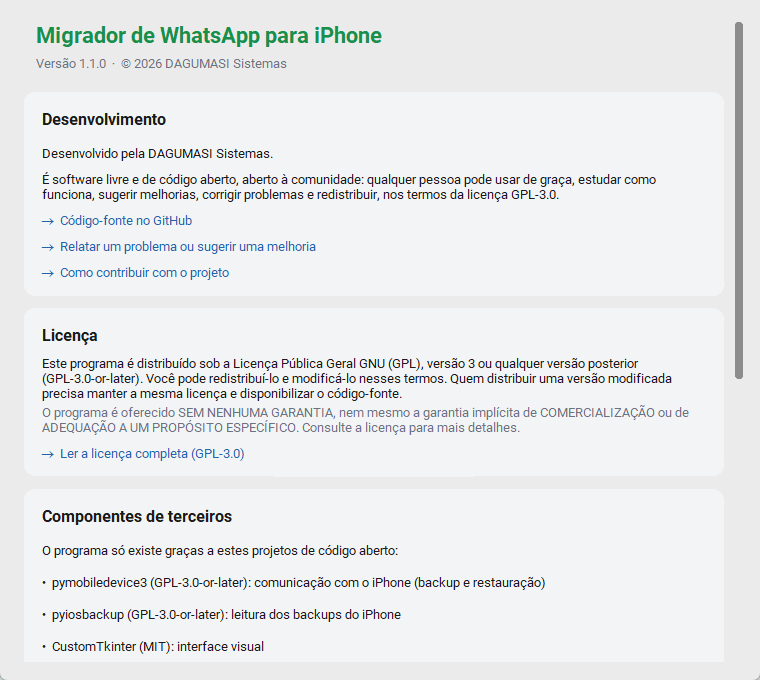

# Migrador de WhatsApp para iPhone

Programa gratuito e de código aberto para Windows, desenvolvido pela **DAGUMASI Sistemas** e aberto à comunidade, que transfere o WhatsApp (com todas as conversas, fotos, vídeos e áudios) de um iPhone para outro **por cabo, usando o PC**. Não depende do backup do iCloud nem da transferência do próprio WhatsApp, que costumam falhar com históricos grandes (100 GB, 200 GB ou mais).


## Como funciona

1. **Preparação.** O programa confere o PC sozinho: app Apple Devices (ou iTunes) instalado e o serviço da Apple respondendo, iPhones que já confiam neste PC (primeira conexão), notebook na tomada, o que acontece ao fechar a tampa e programas que disputam o iPhone (iTunes, 3uTools, iMazing…). O que não dá para detectar vira uma lista para você marcar.
2. **Conferência.** Com os dois iPhones conectados, o programa verifica o modelo, a versão do iOS (consultando na Apple qual é a mais recente para cada modelo), o espaço no PC e no iPhone novo, se a pasta do backup está fora do OneDrive/Dropbox e aceita gravação, se o WhatsApp está no aparelho antigo e se o "Buscar iPhone" está desligado no novo. Se algo impedir a migração, ele diz exatamente o que fazer.
3. **Backup.** O PC faz um backup completo e criptografado do iPhone antigo, igual ao do iTunes/Finder. O iPhone antigo não é apagado nem alterado.
4. **Verificação.** O programa abre o backup e confere:
   - que cada arquivo listado no índice existe e tem o tamanho esperado;
   - que o banco de conversas do WhatsApp passa no teste de integridade do SQLite e tem mensagens;
   - que cada anexo citado nas conversas está no backup (os ausentes são contados e mostrados);
   - que até 40 mídias sorteadas são decifradas por inteiro e têm o formato que a extensão indica;
   - que o backup saiu criptografado.

   Por fim, ele registra o tamanho e a data de modificação de todos os arquivos. Só com o backup aprovado ele libera o passo seguinte.
5. **Restauração.** O backup vai para o iPhone novo, o mesmo escolhido na conferência.
6. **Conferência no iPhone novo.** Depois que ele reinicia, o programa confere se o WhatsApp voltou e se o volume de dados é compatível com o do iPhone antigo. Você marca se as conversas e as mídias antigas aparecem.

## O que o programa garante e o que não garante

**Garante:**
- O iPhone antigo nunca é apagado nem modificado. A única mudança é ativar a senha de backup, que é um ajuste do sistema.
- O iPhone novo só é tocado depois que o backup foi verificado e aprovado.
- Antes de restaurar, o programa refaz o inventário do backup: o tamanho e a data de modificação de **cada** arquivo, mais o SHA-256 dos arquivos de controle (Manifest, Status e Info.plist). Qualquer arquivo alterado, apagado ou novo bloqueia a restauração. Ele também confere que o iOS e o espaço do novo comportam o backup.
- Só o iPhone escolhido como novo na conferência pode receber o backup. Outro iPhone conectado nunca é escolhido sozinho, nem o antigo.
- O progresso fica salvo. É possível fechar o programa e retomar depois na mesma etapa, inclusive após uma atualização.
- Todas as operações ficam registradas em arquivos de log, sem senhas.
- O Windows não entra em suspensão durante backup e restauração.

**Pausar e continuar, com precisão:**
- **Primeira cópia do backup:** se for interrompida (cabo, energia ou botão **Parar**), ela **recomeça do zero** na próxima tentativa. É uma limitação do protocolo de backup da Apple, e o iTunes e o Finder também agem assim. Com um WhatsApp de 200 GB, isso custa horas: evite interromper.
- **Depois que um backup termina,** as cópias seguintes só atualizam o que mudou e podem ser interrompidas e repetidas sem grande custo.
- **Verificação:** pode ser interrompida e refeita quantas vezes quiser.
- **Restauração:** não pode ser pausada. Se for interrompida, é refeita desde o começo; o backup no PC continua intacto.

**Limites conhecidos:**
- A verificação prova que o backup está completo e legível. Ela não abre cada foto: decifra uma amostra. E um anexo que já não existia no iPhone antigo também não estará no backup; o programa conta esses casos e avisa.
- O inventário detecta alterações feitas por programas comuns (que mudam a data do arquivo). Para não reler centenas de GB, ele não recalcula o hash do conteúdo de cada mídia.
- Os testes automáticos usam backups criptografados de verdade, no formato da Apple, mas gerados pelo próprio programa. A restauração em si só pode ser testada com iPhones reais. Acompanhe de perto as primeiras migrações e envie o diagnóstico se algo sair diferente.

**Não dá para garantir 100%**, e nenhum programa garante, porque parte do processo depende da Apple e do WhatsApp. Por exemplo, o WhatsApp pode exigir a confirmação do número por SMS, e o iPhone baixa os apps da App Store depois da restauração. Por isso o iPhone antigo continua intacto como garantia até você conferir tudo no novo.

## Instalação

No PC com Windows 10 ou 11, abra o **PowerShell** e cole:

```powershell
irm https://raw.githubusercontent.com/olegantonov/whatsapp-iphone-migrador/main/instalar.ps1 | iex
```

O instalador baixa a última versão, confere a integridade (SHA-256), instala em `%LOCALAPPDATA%\Programs\MigradorWhatsApp` sem pedir administrador e cria atalhos na Área de Trabalho e no menu Iniciar.

Outra opção é baixar o `MigradorWhatsApp-win64.zip` em [Releases](https://github.com/olegantonov/whatsapp-iphone-migrador/releases/latest), extrair e abrir `MigradorWhatsApp.exe`.

> Na primeira execução, o Windows pode mostrar "O Windows protegeu o computador", porque o programa não tem assinatura digital paga. Clique em **Mais informações → Executar assim mesmo**.

**Requisito:** o app **Apple Devices** (Microsoft Store) ou o **iTunes** precisa estar instalado. Ele traz o serviço do Windows que conversa com iPhones. Abra-o uma vez depois de instalar.

## Atualizações automáticas

O programa verifica se existe uma versão nova ao abrir e a cada 6 horas. Quando existe, aparece uma faixa verde com o botão **Atualizar agora**. Ele baixa, confere o SHA-256, troca os arquivos e reabre. A atualização nunca interrompe um backup ou uma restauração em andamento, e o progresso da migração é mantido. Se a troca falhar, a versão anterior é restaurada.

## Passo a passo para o usuário

### Antes de tudo
- Tenha **tempo**. Com um WhatsApp de ~200 GB, o backup leva de 2 a 5 horas e a restauração, outro tanto.
- Tenha **espaço no PC** do tamanho do conteúdo do iPhone antigo, mais uma folga de 10 GB. O programa sugere o disco com mais espaço livre e aceita um HD externo em NTFS.
- Use **cabos de dados**, como os que vêm com o iPhone.
- Deixe os dois iPhones e o PC **na tomada**.

### 1. Início
Escolha **iPhones reais**. O modo **Simulação** serve para treinar o passo a passo sem aparelhos; veja abaixo.

### 2. Preparação
O programa verifica o PC sozinho e mostra cada item com ✔, ⚠ ou ✖ e o que fazer:

| Verificação | Bloqueia quando |
|---|---|
| App Apple Devices ou iTunes | Nenhum dos dois está instalado (o botão **Abrir a Microsoft Store** leva direto ao app) |
| Serviço da Apple | Instalado, mas o serviço que conversa com iPhones não responde |
| Primeira conexão com este PC | Só avisa se nenhum iPhone confiou no PC ainda; cada iPhone é conferido na etapa seguinte |
| Energia | Notebook na bateria (backup e restauração levam horas) |
| Tampa do notebook | Só avisa se fechar a tampa suspende o PC |
| Outros programas de iPhone | iTunes, 3uTools, iMazing, CopyTrans… abertos: aviso aqui, bloqueio na hora do backup e da restauração |

Depois marque o que só você pode conferir: cabos de dados, iPhone novo pronto para ser apagado, WhatsApp atualizado no antigo, iPhones na tomada e a senha do Apple ID em mãos. Essas verificações do PC se repetem antes do backup e antes da restauração.



### 3. Conectar e conferir
Conecte os **dois** iPhones, desbloqueie e toque em **Confiar** em cada um. Clique em **Procurar iPhones**, confira qual é o antigo e qual é o novo (o botão **⇅ Trocar** inverte) e clique em **Conferir tudo**.


- ✔ verde: tudo certo.
- ⚠ laranja: recomendação, não impede.
- ✖ vermelho: precisa ser resolvido. A seta explica como, por exemplo "Atualize o iPhone novo: Ajustes > Geral > Atualização de Software".

O iPhone novo precisa estar na **versão mais recente do iOS** disponível para o modelo dele, e nunca numa versão mais antiga que a do iPhone antigo.

### 4. Senha do backup
- Se o iPhone antigo ainda não tem senha de backup, o programa sugere uma. **Anote-a.** Sem ela o backup não pode ser restaurado. Por segurança, ela também pode ficar guardada no PC, cifrada pela sua conta do Windows.
- Se ele já tem senha, digite a senha existente. Se você a esqueceu, vá no iPhone antigo em *Ajustes > Geral > Transferir ou Redefinir > Redefinir > Redefinir Todos os Ajustes*. Isso não apaga fotos nem conversas.
- O iPhone pode pedir o código de desbloqueio. Digite-o no aparelho.


### 5. Backup do iPhone antigo
Clique em **Iniciar backup**. A tela mostra a porcentagem, o tempo decorrido e o tempo restante. Não use nem desconecte o iPhone e não deixe o PC desligar: se a **primeira** cópia for interrompida, ela recomeça do zero. Se já existir um backup completo, o botão vira **Atualizar backup** e só copia o que mudou.

### 6. Verificar o backup
Acontece automaticamente. O programa mostra quantas conversas, mensagens e mídias do WhatsApp estão no backup. Se algo estiver errado, ele reprova e oferece refazer o backup.


### 7. Preparar o iPhone novo
1. Desconecte o iPhone antigo. **Não apague nada nele.**
2. No iPhone novo: *Ajustes > Geral > Transferir ou Redefinir o iPhone > Apagar Conteúdo e Ajustes*.
3. Siga a configuração inicial até a tela **Transferir Apps e Dados** e escolha **Do Mac ou PC**.
4. Conecte o iPhone novo ao PC e toque em **Confiar**.
5. Clique em **Conferir iPhone novo**, marque que está ciente e clique em **Restaurar agora**.

Se preferir não apagar o iPhone novo, deixe-o configurado e desligue o **Buscar iPhone** nele. A restauração substitui o conteúdo do mesmo jeito.


### 8. Restaurar no iPhone novo
Não desconecte o cabo. O iPhone mostra "Restaurando…" e reinicia sozinho ao final.

### 9. Concluído: no iPhone novo
1. Termine a configuração e entre com o seu Apple ID.
2. Deixe o iPhone no Wi-Fi e na tomada. Os apps, incluindo o WhatsApp, são baixados da App Store automaticamente.
3. **Espere o WhatsApp terminar de baixar. Não apague nem reinstale o app.**
4. Abra o WhatsApp e confirme o número por SMS.
5. No programa, conecte o iPhone novo e clique em **Conferir o WhatsApp no iPhone novo**. Ele mostra se o app já foi instalado e compara o volume de dados com o do iPhone antigo.
6. Confira se as conversas antigas e as mídias aparecem e marque em **Registrar conferência**. Se algo não veio, use **Algo não veio: pedir ajuda**.
7. Só depois de conferir tudo, apague o backup do PC. Ele contém todo o conteúdo do iPhone antigo.



## Modo simulação (treino)

Na tela inicial, escolha **Simulação** e uma situação: tudo certo, iPhone novo desatualizado, sem espaço, Buscar iPhone ligado, cabo desconectando no meio do backup, backup corrompido, senha de backup já existente (senha `1234`) e outras. O programa percorre as mesmas telas e roda a mesma verificação de backup usada com aparelhos reais, sobre um backup falso gerado com a estrutura de um backup verdadeiro e criptografado com a senha escolhida (keybag, chave por arquivo e Manifest.db cifrado, como no iPhone). Uma faixa laranja deixa claro que nada é real.

Também dá para abrir direto no modo simulação: `MigradorWhatsApp.exe --simulacao`.

## Problemas comuns

| Sintoma | O que fazer |
|---|---|
| "Serviço da Apple não está rodando" | Instale o **Apple Devices** pela Microsoft Store (ou o iTunes) e abra-o uma vez. |
| iPhone não aparece | Troque o cabo ou a porta USB, desbloqueie o iPhone e toque em **Confiar**. |
| "iPhone aguardando confirmação" | Desbloqueie o iPhone, toque em **Confiar**, digite o código e procure de novo. |
| "iOS do iPhone novo" em vermelho | *Ajustes > Geral > Atualização de Software* no iPhone novo. |
| "Buscar iPhone" em vermelho | No iPhone novo: *Ajustes > [seu nome] > Buscar > Buscar iPhone > desativar*. Ou apague-o e pare na tela de configuração. |
| Falta espaço no PC | Escolha uma pasta em outro disco (NTFS), como um HD externo. |
| Backup parou | Na primeira cópia, clique em **Recomeçar o backup**; ela começa do zero. Se já havia um backup completo, clique em **Atualizar backup**, que só copia o que mudou. |

Os registros ficam em `%LOCALAPPDATA%\MigradorWhatsApp\logs` (botão **Abrir registros** no programa): um arquivo por vez que o programa é aberto, mais `atualizacao.log` para as atualizações automáticas. Senhas nunca são gravadas nos registros. Ao final da migração, **Salvar relatório** gera um resumo em texto.

Para pedir ajuda, use **Gerar diagnóstico para o suporte**. Ele cria um .zip com os registros recentes e o andamento da migração. Antes de gravar o arquivo, o programa troca os números de série dos iPhones, os nomes dos aparelhos e o nome do usuário do Windows por marcadores. Nada é enviado sozinho: quem decide para onde mandar o arquivo é você.

## Privacidade

O programa não envia conversas, fotos, contatos nem qualquer conteúdo dos iPhones para lugar nenhum: o backup fica só no disco escolhido. Ele acessa a internet para:

1. consultar no GitHub se há versão nova;
2. consultar na Apple a versão mais recente do iOS de cada modelo;
3. **se você permitir** (a pergunta aparece na primeira vez que o programa abre, e dá para mudar em **Saiba mais**), enviar dados anônimos de funcionamento ao servidor do projeto.

Esses dados contam em que etapa a migração está, os erros, o tempo gasto, o modelo, a versão do iOS e o espaço dos iPhones, e as versões do programa e do Windows. Nunca vão nomes de aparelho, números de série, nome de usuário, senhas, conversas ou caminhos de anexos. Cada PC é identificado só por um número aleatório. Os dados ficam guardados por 180 dias.

O botão **Enviar diagnóstico ao suporte** manda os registros anonimizados só quando você clica, e mostra um protocolo para informar ao suporte.

---

## Para desenvolvedores

```powershell
py -3.12 -m venv .venv
.venv\Scripts\python -m pip install -r requirements-dev.txt
.venv\Scripts\python main.py --simulacao   # interface
.venv\Scripts\python -m pytest             # testes
.venv\Scripts\python main.py --autoteste   # migração simulada completa, sem interface
```

Estrutura:

| Arquivo | Papel |
|---|---|
| `migrador/motor.py` | Orquestra as etapas e confere as pré-condições de cada uma |
| `migrador/checagens.py` | Regras de bloqueio e aviso (iOS, espaço, Buscar iPhone…) |
| `migrador/verificacao.py` | Abre o backup (cifrado ou não), decifra em blocos e confere arquivos, anexos, amostra de mídias e banco do WhatsApp; gera o inventário |
| `migrador/sistema.py` | Lê o PC: app/serviço da Apple, confiança, energia, tampa, programas concorrentes, pasta na nuvem |
| `migrador/telemetria.py` | Eventos anônimos (com consentimento) e envio do diagnóstico |
| `migrador/diagnostico.py` | Pacote de diagnóstico com logs anonimizados |
| `servidor/` | Cloudflare Worker + D1 que recebe os eventos e diagnósticos ([detalhes](servidor/README.md)) |
| `migrador/dispositivos/real.py` | Comunicação com o iPhone via [pymobiledevice3](https://github.com/doronz88/pymobiledevice3) |
| `migrador/dispositivos/simulado.py` | iPhones e backups falsos para treino e testes |
| `migrador/estado.py` | Progresso salvo em disco (retomada) |
| `migrador/atualizador.py` | Atualização automática pelas Releases |
| `migrador/interface.py` | Interface (CustomTkinter) |

### Publicar uma atualização

1. Faça as alterações e rode `pytest`.
2. Aumente o número em [`migrador/versao.py`](migrador/versao.py), por exemplo `1.0.0` → `1.0.1`.
3. Faça commit e `git push` na `main`.

O GitHub Actions ([`publicar.yml`](.github/workflows/publicar.yml)) roda os testes, gera o executável, executa o autoteste com o `.exe` gerado e publica a release `vX.Y.Z` com o `.zip` e o `.sha256`. Todos os PCs com o programa instalado recebem a atualização. Um push sem mudança de versão só roda os testes.

## Sobre o projeto

Desenvolvido pela **DAGUMASI Sistemas**. É software livre e aberto à comunidade: use, estude, modifique e redistribua nos termos da licença. Relatos de problemas, sugestões e contribuições são bem-vindos. Veja [Como contribuir](CONTRIBUTING.md) ou [abra uma issue](https://github.com/olegantonov/whatsapp-iphone-migrador/issues/new/choose).

No programa, o botão **Saiba mais: sobre e licenças** mostra estas informações, a licença completa e as licenças de todos os componentes de terceiros incluídos no executável.



## Licença

Copyright © 2026 DAGUMASI Sistemas.

Este programa é software livre: você pode redistribuí-lo e/ou modificá-lo sob os termos da [Licença Pública Geral GNU](LICENSE), versão 3 ou (a seu critério) qualquer versão posterior (**GPL-3.0-or-later**). A GPL é a mesma licença do pymobiledevice3 e do pyiosbackup, que o programa usa. Ele é distribuído na esperança de ser útil, mas **sem nenhuma garantia**, nem mesmo a garantia implícita de comercialização ou de adequação a um propósito específico.

Componentes de terceiros mantêm suas próprias licenças (MIT, BSD, Apache-2.0, PSF, GPL). A lista completa, com os textos, é gerada no empacotamento e acompanha o executável (`TERCEIROS.txt`).

WhatsApp é marca da Meta Platforms, Inc. iPhone, iOS, iTunes e iCloud são marcas da Apple Inc. Este projeto é independente e não tem vínculo com a Meta nem com a Apple.
