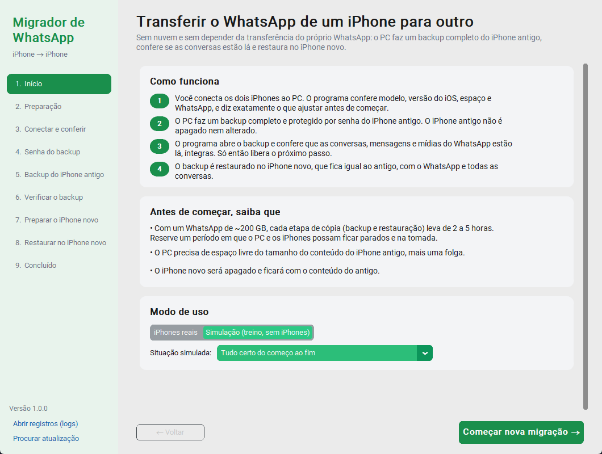
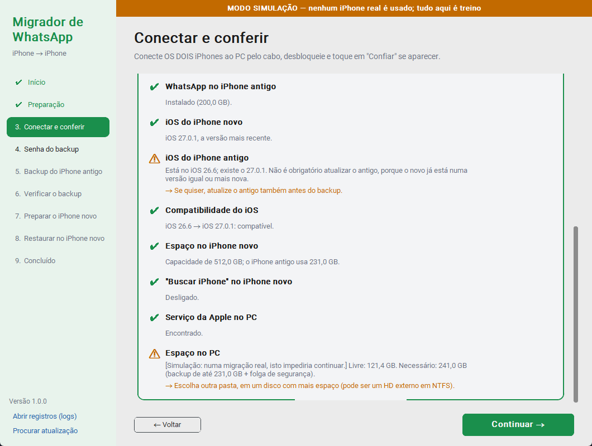
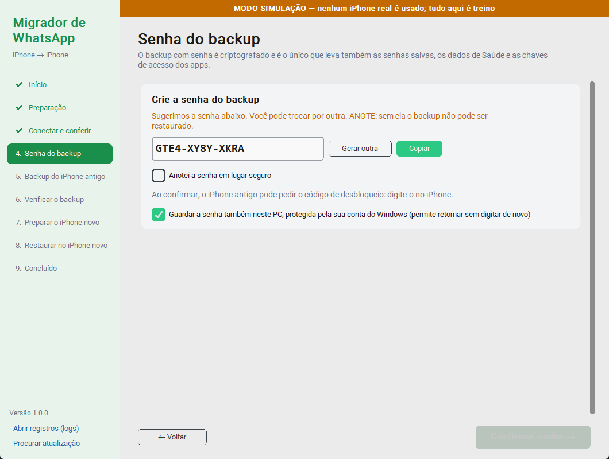
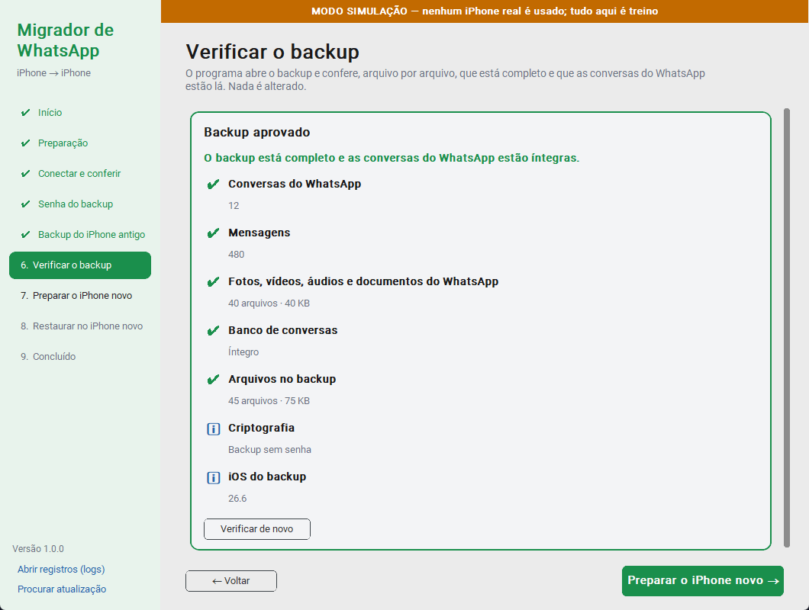
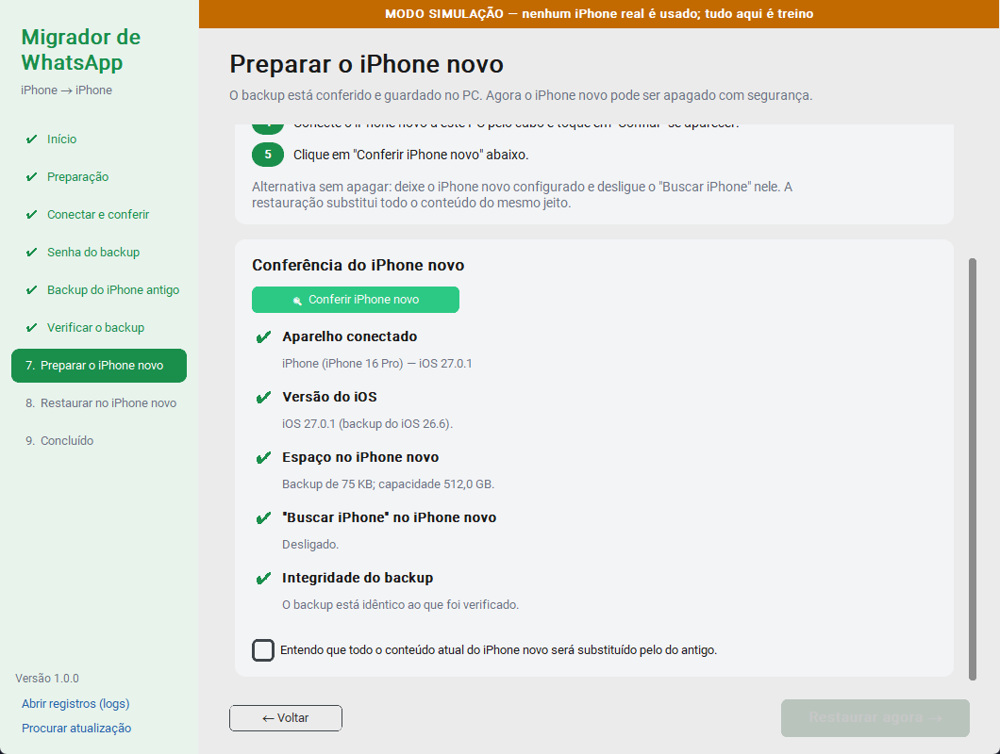

# Migrador de WhatsApp para iPhone

Programa gratuito e de código aberto para Windows que transfere o WhatsApp (com todas as conversas, fotos, vídeos e áudios) de um iPhone para outro **por cabo, usando o PC**. Não depende do backup do iCloud nem da transferência do próprio WhatsApp, que costumam falhar com históricos grandes (100 GB, 200 GB ou mais).



## Como funciona

1. **Conferência.** Com os dois iPhones conectados, o programa verifica o modelo, a versão do iOS (consultando na Apple qual é a mais recente para cada modelo), o espaço no PC e no iPhone novo, se o WhatsApp está no aparelho antigo e se o "Buscar iPhone" está desligado no novo. Se algo impedir a migração, ele diz exatamente o que fazer.
2. **Backup.** O PC faz um backup completo e criptografado do iPhone antigo, igual ao do iTunes/Finder. O iPhone antigo não é apagado nem alterado.
3. **Verificação.** O programa abre o backup e confere arquivo por arquivo que está completo, que o banco de conversas do WhatsApp está íntegro e quantas conversas, mensagens e mídias existem. Só com o backup aprovado ele libera o passo seguinte.
4. **Restauração.** O backup vai para o iPhone novo, que fica igual ao antigo, com o WhatsApp e todo o histórico.

## O que o programa garante e o que não garante

**Garante:**
- O iPhone antigo nunca é apagado nem modificado. A única mudança é ativar a senha de backup, que é um ajuste do sistema.
- O iPhone novo só é tocado depois que o backup foi verificado e aprovado.
- Antes de restaurar, o programa confere que o backup no disco está idêntico ao que foi verificado (impressão digital SHA-256), que o aparelho conectado não é o antigo e que o iOS e o espaço do novo comportam o backup.
- Se algo cair no meio do backup (cabo, energia), nada se perde: o backup continua de onde parou.
- O progresso fica salvo. É possível fechar o programa e retomar depois, inclusive após uma atualização.
- O Windows não entra em suspensão durante backup e restauração.

**Não dá para garantir 100%**, e nenhum programa garante, porque parte do processo depende da Apple e do WhatsApp. Por exemplo, o WhatsApp pode exigir a confirmação do número por SMS, e o iPhone baixa os apps da App Store depois da restauração. Por isso o iPhone antigo continua intacto como garantia até você conferir tudo no novo.

## Instalação

No PC com Windows 10 ou 11, abra o **PowerShell** e cole:

```powershell
irm https://raw.githubusercontent.com/olegantonov/whatsapp-iphone-migrador/main/instalar.ps1 | iex
```

O instalador baixa a última versão, confere a integridade (SHA-256), instala em `%LOCALAPPDATA%\Programs\MigradorWhatsApp` sem pedir administrador e cria atalhos na Área de Trabalho e no menu Iniciar.

Outra opção é baixar o `MigradorWhatsApp-win64.zip` em [Releases](https://github.com/olegantonov/whatsapp-iphone-migrador/releases/latest), extrair e abrir `MigradorWhatsApp.exe`.

> Na primeira execução, o Windows pode mostrar "O Windows protegeu o computador", porque o programa não tem assinatura digital paga. Clique em **Mais informações → Executar assim mesmo**.

**Requisito:** o app **Apple Devices** (Microsoft Store) ou o **iTunes** precisa estar instalado. Ele traz o serviço do Windows que conversa com iPhones. Abra-o uma vez depois de instalar.

## Atualizações automáticas

O programa verifica se existe uma versão nova ao abrir e a cada 6 horas. Quando existe, aparece uma faixa verde com o botão **Atualizar agora**. Ele baixa, confere o SHA-256, troca os arquivos e reabre. A atualização nunca interrompe um backup ou uma restauração em andamento, e o progresso da migração é mantido. Se a troca falhar, a versão anterior é restaurada.

## Passo a passo para o usuário

### Antes de tudo
- Tenha **tempo**. Com um WhatsApp de ~200 GB, o backup leva de 2 a 5 horas e a restauração, outro tanto.
- Tenha **espaço no PC** do tamanho do conteúdo do iPhone antigo, mais uma folga de 10 GB. O programa sugere o disco com mais espaço livre e aceita um HD externo em NTFS.
- Use **cabos de dados**, como os que vêm com o iPhone.
- Deixe os dois iPhones e o PC **na tomada**.

### 1. Início
Escolha **iPhones reais**. O modo **Simulação** serve para treinar o passo a passo sem aparelhos; veja abaixo.

### 2. Preparação
Marque os itens da lista: Apple Devices instalado, cabos, iPhone novo pronto para ser apagado, WhatsApp atualizado no antigo e aparelhos na tomada.

### 3. Conectar e conferir
Conecte os **dois** iPhones, desbloqueie e toque em **Confiar** em cada um. Clique em **Procurar iPhones**, confira qual é o antigo e qual é o novo (o botão **⇅ Trocar** inverte) e clique em **Conferir tudo**.



- ✔ verde: tudo certo.
- ⚠ laranja: recomendação, não impede.
- ✖ vermelho: precisa ser resolvido. A seta explica como, por exemplo "Atualize o iPhone novo: Ajustes > Geral > Atualização de Software".

O iPhone novo precisa estar na **versão mais recente do iOS** disponível para o modelo dele, e nunca numa versão mais antiga que a do iPhone antigo.

### 4. Senha do backup
- Se o iPhone antigo ainda não tem senha de backup, o programa sugere uma. **Anote-a.** Sem ela o backup não pode ser restaurado. Por segurança, ela também pode ficar guardada no PC, cifrada pela sua conta do Windows.
- Se ele já tem senha, digite a senha existente. Se você a esqueceu, vá no iPhone antigo em *Ajustes > Geral > Transferir ou Redefinir > Redefinir > Redefinir Todos os Ajustes*. Isso não apaga fotos nem conversas.
- O iPhone pode pedir o código de desbloqueio. Digite-o no aparelho.



### 5. Backup do iPhone antigo
Clique em **Iniciar backup**. A tela mostra a porcentagem, o tempo decorrido e o tempo restante. Não use nem desconecte o iPhone. Se a conexão cair, clique em **Tentar de novo** e o backup continua de onde parou.

### 6. Verificar o backup
Acontece automaticamente. O programa mostra quantas conversas, mensagens e mídias do WhatsApp estão no backup. Se algo estiver errado, ele reprova e oferece refazer o backup.



### 7. Preparar o iPhone novo
1. Desconecte o iPhone antigo. **Não apague nada nele.**
2. No iPhone novo: *Ajustes > Geral > Transferir ou Redefinir o iPhone > Apagar Conteúdo e Ajustes*.
3. Siga a configuração inicial até a tela **Transferir Apps e Dados** e escolha **Do Mac ou PC**.
4. Conecte o iPhone novo ao PC e toque em **Confiar**.
5. Clique em **Conferir iPhone novo**, marque que está ciente e clique em **Restaurar agora**.

Se preferir não apagar o iPhone novo, deixe-o configurado e desligue o **Buscar iPhone** nele. A restauração substitui o conteúdo do mesmo jeito.



### 8. Restaurar no iPhone novo
Não desconecte o cabo. O iPhone mostra "Restaurando…" e reinicia sozinho ao final.

### 9. Concluído: no iPhone novo
1. Termine a configuração e entre com o seu Apple ID.
2. Deixe o iPhone no Wi-Fi e na tomada. Os apps, incluindo o WhatsApp, são baixados da App Store automaticamente.
3. **Espere o WhatsApp terminar de baixar. Não apague nem reinstale o app.**
4. Abra o WhatsApp e confirme o número por SMS. As conversas estarão lá.
5. Só depois de conferir tudo, apague o backup do PC. Ele contém todo o conteúdo do iPhone antigo.

## Modo simulação (treino)

Na tela inicial, escolha **Simulação** e uma situação: tudo certo, iPhone novo desatualizado, sem espaço, Buscar iPhone ligado, cabo desconectando no meio do backup, backup corrompido, senha de backup já existente (senha `1234`) e outras. O programa percorre as mesmas telas e roda a mesma verificação de backup usada com aparelhos reais, sobre um backup falso gerado com a estrutura de um backup verdadeiro. Uma faixa laranja deixa claro que nada é real.

Também dá para abrir direto no modo simulação: `MigradorWhatsApp.exe --simulacao`.

## Problemas comuns

| Sintoma | O que fazer |
|---|---|
| "Serviço da Apple não está rodando" | Instale o **Apple Devices** pela Microsoft Store (ou o iTunes) e abra-o uma vez. |
| iPhone não aparece | Troque o cabo ou a porta USB, desbloqueie o iPhone e toque em **Confiar**. |
| "iPhone aguardando confirmação" | Desbloqueie o iPhone, toque em **Confiar**, digite o código e procure de novo. |
| "iOS do iPhone novo" em vermelho | *Ajustes > Geral > Atualização de Software* no iPhone novo. |
| "Buscar iPhone" em vermelho | No iPhone novo: *Ajustes > [seu nome] > Buscar > Buscar iPhone > desativar*. Ou apague-o e pare na tela de configuração. |
| Falta espaço no PC | Escolha uma pasta em outro disco (NTFS), como um HD externo. |
| Backup parou | Clique em **Tentar de novo**. Ele continua de onde parou. |

Os registros ficam em `%LOCALAPPDATA%\MigradorWhatsApp\logs` (botão **Abrir registros** no programa). Senhas nunca são gravadas nos registros.

---

## Para desenvolvedores

```powershell
py -3.12 -m venv .venv
.venv\Scripts\python -m pip install -r requirements-dev.txt
.venv\Scripts\python main.py --simulacao   # interface
.venv\Scripts\python -m pytest             # testes
.venv\Scripts\python main.py --autoteste   # migração simulada completa, sem interface
```

Estrutura:

| Arquivo | Papel |
|---|---|
| `migrador/motor.py` | Orquestra as etapas e confere as pré-condições de cada uma |
| `migrador/checagens.py` | Regras de bloqueio e aviso (iOS, espaço, Buscar iPhone…) |
| `migrador/verificacao.py` | Abre o backup (cifrado ou não) e confere arquivos e o banco do WhatsApp |
| `migrador/dispositivos/real.py` | Comunicação com o iPhone via [pymobiledevice3](https://github.com/doronz88/pymobiledevice3) |
| `migrador/dispositivos/simulado.py` | iPhones e backups falsos para treino e testes |
| `migrador/estado.py` | Progresso salvo em disco (retomada) |
| `migrador/atualizador.py` | Atualização automática pelas Releases |
| `migrador/interface.py` | Interface (CustomTkinter) |

### Publicar uma atualização

1. Faça as alterações e rode `pytest`.
2. Aumente o número em [`migrador/versao.py`](migrador/versao.py), por exemplo `1.0.0` → `1.0.1`.
3. Faça commit e `git push` na `main`.

O GitHub Actions ([`publicar.yml`](.github/workflows/publicar.yml)) roda os testes, gera o executável, executa o autoteste com o `.exe` gerado e publica a release `v1.0.1` com o `.zip` e o `.sha256`. Todos os PCs com o programa instalado recebem a atualização. Um push sem mudança de versão só roda os testes.

## Licença

GPL-3.0-or-later, a mesma do pymobiledevice3, que o programa usa. WhatsApp, iPhone e iOS são marcas de seus respectivos donos. Este projeto não tem vínculo com a Meta nem com a Apple.
